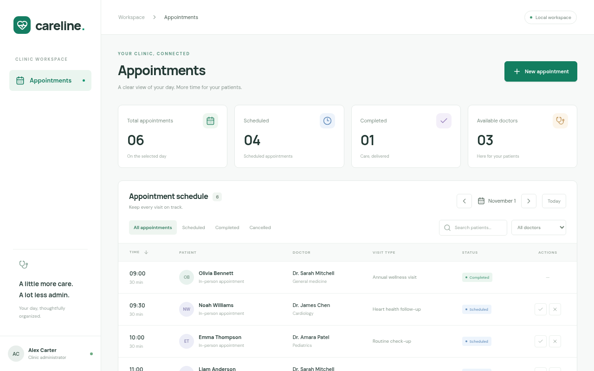

# Careline · Doctor appointment management

A local development app built with **TanStack Start + React**, a separate **Fastify** API, and **local Supabase (PostgreSQL)**. Book 30-minute appointments, search patients, filter by date/doctor/status, and complete or cancel visits. All schedule times are **UTC**.

## Run locally

Requires Node.js 22.12+ (Node 24 recommended), npm, and a running Docker daemon. Supabase downloads its containers on first startup.

```sh
npm ci
cp .env.example .env
npm run db:start
npm run dev
```

Open **http://localhost:3000**. Fastify runs at **http://localhost:3001**; Supabase Studio runs at **http://localhost:54323**. The web server proxies `/api` to Fastify, so the browser only needs port 3000. No cloud Supabase account or browser credentials are needed.

The initial database startup applies migrations and seeds three fictional doctors and six appointments for today's UTC date. If an existing local database was created before a migration changed, apply the current schema and refresh sample data with:

```sh
npm run db:reset
```

**Reset deletes the local database contents.** Stop web/API with Ctrl+C and stop Supabase with `npm run db:stop` (data is preserved). Use `npm run db:reset` explicitly when you want a clean database.

## Configuration

Copy `.env.example` to the root `.env`. Defaults work without it.

| Variable           | Default / purpose                                    |
| ------------------ | ---------------------------------------------------- |
| `DATABASE_URL`     | Local Supabase PostgreSQL at port 54322; server only |
| `API_PORT`         | 3001                                                 |
| `API_PROXY_TARGET` | http://127.0.0.1:3001; optional Vite proxy override  |

The API automatically reads the root `.env`. To override the web proxy, set `API_PROXY_TARGET` in the shell running `npm run dev`. No environment values are exposed to client code. Fonts are bundled locally.

## Checks

Start Supabase before database and browser tests:

```sh
npm run format:check
npm test
npm run test:db
npm run typecheck
npm run build
npm run test:e2e
```

Playwright uses `/usr/bin/chromium` by default. On another system install Chromium or run `npx playwright install chromium` and set `CHROMIUM_PATH` to that executable. Browser tests start the app automatically if port 3000 is free. They exercise the real API/database, use fictional test patients, and leave their test visits cancelled. The database integration test creates and removes an isolated doctor and appointments.

Unit tests exercise validation and safe error responses with a test-only store. Database tests use actual local Supabase and prove persistence through a separate connection, concurrent conflict prevention, adjacent appointments, cancellation and rebooking. Browser coverage includes booking, reload persistence, conflicts, filters, completion/cancellation, keyboard focus, mobile layout and error recovery.

## Layout and API

- `apps/web`: TanStack Start file-based routes, React UI, locally bundled fonts, Vite same-origin API proxy.
- `apps/api`: Fastify routes, Zod validation, PostgreSQL store and tests.
- `supabase`: local configuration, migration and fictional seeds.
- `tests`: Chromium end-to-end checks.

| Endpoint                      | Behavior                                                            |
| ----------------------------- | ------------------------------------------------------------------- |
| `GET /api/health`             | Checks database connectivity                                        |
| `GET /api/doctors`            | Lists doctors                                                       |
| `GET /api/appointments`       | Lists appointments ordered by start time                            |
| `POST /api/appointments`      | Books `patient_name`, `doctor_id`, future ISO `starts_at`, `reason` |
| `PATCH /api/appointments/:id` | Updates `status`: scheduled, completed or cancelled                 |

PostgreSQL enforces non-overlapping 30-minute visits per doctor, including concurrent requests. Cancelled visits release their slot. Fastify returns 400 for invalid inputs, 404 for missing records, 409 for conflicts and 503 when the database is unavailable. The UI shows errors and retry without replacing data with mocks.

## Local scaffold boundaries

This workspace has **no authentication**, one clinic, seeded doctors and no patient directory, billing or notifications. Use fictional data only. Fastify uses the local database owner connection; RLS is enabled and anonymous/authenticated Supabase Data API access to these tables is revoked. Authentication, scoped database roles, authorization and audit trails are needed before any real clinic use. Development servers bind to 0.0.0.0 for workspace previews; keep the stack on a trusted development machine.

`npm run build` compiles the API and TanStack Start client/server bundles. `npm run start -w @docsapp/web` uses Vite preview for local inspection only; it is not a production deployment setup.


